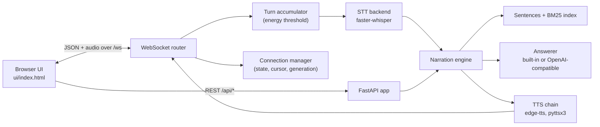

# Interactive voice agent

[](https://github.com/uditdaftary/interactive-voice-agent/actions/workflows/ci.yml)


A local web app that reads a document aloud, lets you interrupt by voice or text, answers the question, and resumes from where it stopped.

## What problem it solves

Audiobook-style readers are one-way. If you want to ask "who is that character?" mid-sentence you have to stop, search, and find your place again. This project treats the interruption as a first-class event: playback stops when you speak, the question is answered using the current reading position and nearby passages as context, and narration continues from the interrupted sentence.

## Features

- **Document ingestion**: upload PDF, EPUB, TXT or Markdown, or paste text. Parsing runs off the event loop and is bounded (page, archive member and uncompressed size limits for PDF and EPUB).
- **Narration with a word cursor**: a sentence splitter that protects abbreviations, initials and decimals, a cursor (sentence and word), and cadence control from 0.1x to 3.0x.
- **One listening tab**: the audio plays in one browser tab, and only that tab's microphone, Speak button and playback reports count. It is the tab that first sends microphone audio or picks the microphone, else the oldest one, so a tab without microphone permission still hears the narration. Other tabs get state and text, say "Audio is playing in another tab", and can take over with the Speak button. Pause, resume, next, previous, voice, cadence and typed questions work from any tab.
- **Narration paced by the browser**: the browser reports each clip when it has finished playing. Narration stays one sentence ahead of what you hear (the next sentence is synthesized while the current one plays), the word cursor holds on the last word until the clip is done, and after an interruption a sentence you were partway through starts again about four words before where you stopped. If the browser never reports, narration pauses with an error after 30 seconds past the clip's estimated length; a reply goes on instead.
- **Voice interruption**: the browser streams 16 kHz PCM over WebSocket. An energy-based turn accumulator keeps about one second of pre-roll so the first consonant is not clipped, ends a turn after a silence timeout, and caps a turn at 30 seconds. A barge-in bumps a generation counter, moves the session to `LISTENING`, resets the partial turn and tells the browser to stop playback.
- **Speech recognition**: faster-whisper on CPU behind a backend protocol, with a speech judge that withholds output for audio that is too quiet or does not look like speech.
- **Question answering**: BM25 passage retrieval over the loaded document with a boost for passages near the cursor, optional DuckDuckGo search grounding, and prompt sanitising. Answers come from a model behind an OpenAI-compatible endpoint, Ollama by default. If none is reachable the app says so instead of guessing.
- **Speech synthesis**: Edge neural voices with per-character pitch and rate profiles, with `pyttsx3` as fallback.
- **Local web UI**: a single-page dashboard served by the same FastAPI process, with live transcript, cursor, voice roster and telemetry over one WebSocket.
- **Local-server safety**: loopback Host allowlist, same-origin checks on HTTP and WebSocket, JSON content-type enforcement, and validated request bodies.
- **Audio building blocks with tests**: a thread-safe ring buffer whose drain applies a 2 ms fade and rejects stale writes by generation, a 30 ms-frame voice activity detector with DC blocking and an adaptive noise floor, a four-state barge-in state machine, and a microphone bridge that can read the host microphone through `sounddevice`. These are exercised by the tests and the terminal demo; the web server does not use them yet (see limitations).
- **Tests**: a default suite that runs without network access or model downloads, plus opt-in `network` and `slow` markers.

## Architecture



During narration the engine synthesizes one sentence at a time, sends the audio to the browser, and advances a word cursor on a timer. When you speak, the turn accumulator collects the utterance and the speech recognizer transcribes it. The question is answered with passages retrieved around the cursor, the answer is spoken, and narration resumes.

The separate audio building blocks (ring buffer, voice activity detector, state machine, microphone bridge, cursor tracker) are used by `run_agent.py` and their own tests rather than by this server path.

## Tech stack

Python 3.11+, FastAPI, Uvicorn, WebSockets, NumPy, SciPy, pydantic, faster-whisper, edge-tts, pyttsx3, pypdf, ddgs, sounddevice. The frontend is one HTML file with CSS and vanilla JavaScript (Web Audio API). Tooling: pytest, pytest-asyncio, ruff, mypy, GitHub Actions.

## Quickstart

```bash
git clone https://github.com/uditdaftary/interactive-voice-agent.git
cd interactive-voice-agent
python -m venv .venv
source .venv/bin/activate          # Windows: .venv\Scripts\activate
pip install -e ".[dev]"

python -m pytest -q                # default suite of about 500 tests: no network, no model downloads
ruff check .
mypy

python ui/serve.py                 # http://localhost:8000/ (optional port argument)
```

Open `http://localhost:8000/`. The built-in sample story is loaded; use the playback controls to start or pause it, and use the interrupt box or the microphone button to ask a question. `python -m voice_agent.server.app` starts the same server. `python run_agent.py` runs a terminal demo of the barge-in and resume flow with a scripted answer and no audio.

Network needs on first use: Edge TTS and web search call out to the internet, and faster-whisper downloads its `tiny.en` model the first time it transcribes. To stay offline, set `VOICE_AGENT_TTS_PRIMARY=pyttsx3` and `VOICE_AGENT_WEB_SEARCH=false`, and use a pre-downloaded Whisper model. On Linux, `sounddevice` needs PortAudio (`libportaudio2`) and `pyttsx3` needs eSpeak.

## Language model setup

Questions that interrupt the narration go to a model served on this machine by [Ollama](https://ollama.com).

1. Install Ollama.
2. Put the GGUF file in `models/` (it is git-ignored) and register it from the repository root:

   ```bash
   ollama create voice-agent -f models/Modelfile
   ollama run voice-agent "Say hello in one sentence."
   ```

   The Modelfile sets `num_ctx 2048` and leaves the chat template to the one embedded in the GGUF. Check that the reply is a plain sentence and not a reasoning transcript.
3. Start the app. The defaults in the configuration table already point at `http://127.0.0.1:11434/v1` and the model name `voice-agent`.

Without a reachable model the app says "My language model is offline. Check the model settings." and logs the cause (nothing listening, rejected key, server error, or an empty reply). The `builtin` provider is that same no-model mode on purpose. Greetings and the pause, resume and repeat commands are handled locally either way. Changes made through `/api/config` last until the server restarts.

## Project layout

```
src/voice_agent/
  audio/          Ring buffer, microphone bridge, virtual loopback device
  vad/            Energy-based voice activity detector
  stt/            Whisper and Moonshine backends, speech judge, utterance accumulator
  tts/            Edge, pyttsx3 and Pocket backends, fallback chain
  llm/            Streaming model client, prompt builder, local intents, web search grounding
  document/       PDF, EPUB and text parsing, BM25 index
  cursor/         Sentence splitter and reading cursor
  orchestrator/   State machine, prompt assembly and sanitising
  server/         FastAPI app, WebSocket router, security middleware, narration engine
  settings.py     Environment-driven settings
ui/               Single-page UI (index.html, app.css, fonts) and serve.py launcher
tests/            pytest suite
docs/             Design notes and archived audit reports
run_agent.py      Terminal demo
```

## Configuration

Settings are read from environment variables (see `.env.example`; the app does not load that file itself).

| Variable | Default | Purpose |
| --- | --- | --- |
| `VOICE_AGENT_LLM_BASE_URL` | `http://127.0.0.1:11434/v1` | OpenAI-compatible chat endpoint (Ollama's default shown) |
| `VOICE_AGENT_LLM_MODEL` | `voice-agent` | Model name sent to that endpoint |
| `VOICE_AGENT_LLM_API_KEY` | `local` | Bearer token for hosted providers; kept out of logged settings. Use an `https://` URL: the app warns when a key would go over plain `http://` to another machine |
| `VOICE_AGENT_WEB_SEARCH` | `true` | Ground answers with DuckDuckGo results; `0`, `false` or `no` turns it off |
| `VOICE_AGENT_STT_INITIAL_PROMPT` | empty | Names or terms that bias Whisper decoding |
| `VOICE_AGENT_TTS_PRIMARY` | `edge` | `edge`, `pyttsx3` or `pocket`; the other backends are the fallbacks |
| `VOICE_AGENT_STT_BACKEND` | `whisper` | `whisper` or `moonshine`; the backend the server transcribes with |
| `VOICE_AGENT_MOONSHINE_MODEL_DIR` | `models/stt/moonshine-tiny-en-int8` | Folder with the Moonshine model files |
| `VOICE_AGENT_BARGE_IN_LISTEN_S` | `8.0` | Seconds the app waits for you after an interruption before it goes back to what it was doing; extended while you speak. After a click on Speak, the turn ends when you click Stop; only if Stop never comes does the wait start, after 30 seconds |
| `VOICE_AGENT_WEB_SPEECH_PREVIEW` | `false` | Show the browser's Web Speech preview and let it answer a turn the server heard nothing in. Chrome sends that audio to Google, so it needs internet; only `1`, `true`, `yes` or `on` enable it |

The provider, model, voice, cadence and microphone source can also be changed at runtime from the UI or with `POST /api/config`.

How long the server waits for the browser to report a clip played is `Settings.playback_ack_timeout_s` (30 seconds past the clip's estimated length). It has no environment variable.

## Optional local voices

Both optional backends are installed only through extras, so the base install and CI never need them.

- **Pocket TTS** (`pip install -e ".[pocket]"`, which pulls in PyTorch): set `VOICE_AGENT_TTS_PRIMARY=pocket`. Each voice is cloned from `models/voices/<voice_id>.wav` on the CPU. The clips must be 16-bit PCM WAV. A voice without a file speaks in `v-male`, with a warning. The model loads on the first sentence. Its voice-cloning weights on Hugging Face (`kyutai/pocket-tts`) are gated: accept the licence on that page and log in with the Hugging Face CLI before first use. Without access the backend reports an error and the chain falls back to edge-tts or pyttsx3. Voice clips are never committed to this repository.
- **Moonshine STT** (`pip install -e ".[moonshine]"`): set `VOICE_AGENT_STT_BACKEND=moonshine`. Place the Moonshine Tiny English int8 model files (`preprocess.onnx`, `encode.int8.onnx`, `uncached_decode.int8.onnx`, `cached_decode.int8.onnx`, `tokens.txt`) in `models/stt/moonshine-tiny-en-int8`, or point `VOICE_AGENT_MOONSHINE_MODEL_DIR` at them. A local worker process runs the model on the CPU and restarts after a failure.

## Limitations and roadmap

- **Not offline by default.** See the network note in the quickstart.
- **Answers need a local model.** Without a reachable Ollama model the app only answers a few local commands and otherwise says its model is offline. The Modelfile has not been run against a real Ollama install yet, so check the model's reply before relying on it.
- **The ring buffer, voice activity detector, state machine and host microphone bridge are not wired into the web server.** The server detects speech with a simple energy threshold, and the `host` microphone option is stored as a setting but only browser audio is used. Wiring these in is the main open engineering item.
- **Nothing measures the barge-in latency.** The server sends `null` for `latency_ms` and `flushed_samples`, and the UI shows "not measured". The Speak button still shows a placeholder figure the page makes up until the server's answer replaces it. The tests assert the ring buffer drain stays under 1 ms, which covers the buffer only, not microphone to silence.
- **The word cursor is timed, not aligned.** Highlighting steps at an estimated words-per-second rate and holds on the last word until the browser reports the clip played, rather than following audio timestamps. The resume point after an interruption is that estimate, minus four words.
- **No authentication.** The server is meant for loopback use and rejects non-loopback Host headers. Do not expose it on a network.
- **One session.** One narration engine and connection manager serve all connected clients, but only one tab plays audio and records (see "One listening tab").
- **Sample content is themed on a Cyberpunk fan story.** The bundled story, character personas and voice names are fan material and are not affiliated with any rights holder. Voice reference clips are no longer tracked in this repository.
Candidate next steps: wire the audio building blocks and the STT backend setting into the server, and measure the barge-in latency so the UI can show a value.

## License

MIT. See [LICENSE](LICENSE).
