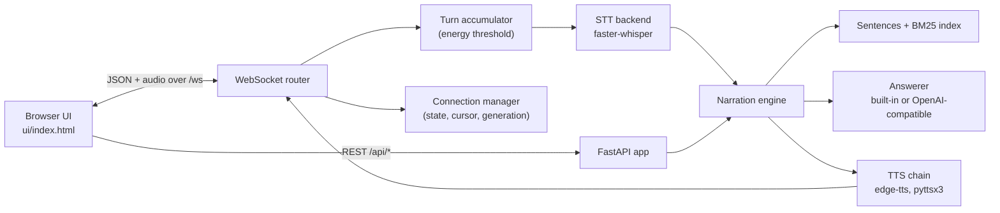

# Interactive voice agent

[](https://github.com/uditdaftary/interactive-voice-agent/actions/workflows/ci.yml)


A local web app that reads a document aloud, lets you interrupt by voice or text, answers the question, and resumes from where it stopped.

## What problem it solves

Audiobook-style readers are one-way. If you want to ask "who is that character?" mid-sentence you have to stop, search, and find your place again. This project treats the interruption as a first-class event: playback stops when you speak, the question is answered using the current reading position and nearby passages as context, and narration continues from the interrupted sentence.

## Features

- **Document ingestion**: upload PDF, EPUB, TXT or Markdown, or paste text. Parsing runs off the event loop and is bounded (page, archive member and uncompressed size limits for PDF and EPUB).
- **Narration with a word cursor**: a sentence splitter that protects abbreviations, initials and decimals, a cursor (sentence and word), and cadence control from 0.1x to 3.0x.
- **Voice interruption**: the browser streams 16 kHz PCM over WebSocket. An energy-based turn accumulator keeps about one second of pre-roll so the first consonant is not clipped, ends a turn after a silence timeout, and caps a turn at 30 seconds. A barge-in bumps a generation counter, moves the session to `LISTENING`, resets the partial turn and tells the browser to stop playback.
- **Speech recognition**: faster-whisper on CPU behind a backend protocol, with a speech judge that withholds output for audio that is too quiet or does not look like speech.
- **Question answering**: BM25 passage retrieval over the loaded document with a boost for passages near the cursor, optional DuckDuckGo search grounding, and prompt sanitising. Answers come from a built-in rule-based answerer by default, or from any OpenAI-compatible endpoint (for example Ollama) if you configure one.
- **Speech synthesis**: Edge neural voices with per-character pitch and rate profiles, with `pyttsx3` as fallback.
- **Local web UI**: a single-page dashboard served by the same FastAPI process, with live transcript, cursor, voice roster and telemetry over one WebSocket.
- **Local-server safety**: loopback Host allowlist, same-origin checks on HTTP and WebSocket, JSON content-type enforcement, and validated request bodies.
- **Audio building blocks with tests**: a thread-safe ring buffer whose drain applies a 2 ms fade and rejects stale writes by generation, a 30 ms-frame voice activity detector with DC blocking and an adaptive noise floor, a four-state barge-in state machine, and a microphone bridge that can read the host microphone through `sounddevice`. These are exercised by the tests and the terminal demo; the web server does not use them yet (see limitations).
- **Tests**: a default suite that runs without network access or model downloads, plus opt-in `network` and `slow` markers.

## Architecture



During narration the engine synthesizes one sentence at a time, sends the audio to the browser, and advances a word cursor on a timer. When you speak, the turn accumulator collects the utterance and the speech recognizer transcribes it. The question is answered with passages retrieved around the cursor, the answer is spoken, and narration resumes.

The separate audio building blocks (ring buffer, voice activity detector, state machine, microphone bridge, cursor tracker) are used by `run_agent.py` and their own tests rather than by this server path.

## Tech stack

Python 3.11+, FastAPI, Uvicorn, WebSockets, NumPy, SciPy, pydantic, faster-whisper, edge-tts, pyttsx3, pypdf, ddgs, sounddevice. The frontend is one HTML file with CSS and vanilla JavaScript (Web Audio API). Tooling: pytest, pytest-asyncio, ruff, mypy, GitHub Actions.

## Quickstart

```bash
git clone https://github.com/uditdaftary/interactive-voice-agent.git
cd interactive-voice-agent
python -m venv .venv
source .venv/bin/activate          # Windows: .venv\Scripts\activate
pip install -e ".[dev]"

python -m pytest -q                # default suite of about 500 tests: no network, no model downloads
ruff check .
mypy

python ui/serve.py                 # http://localhost:8000/ (optional port argument)
```

Open `http://localhost:8000/`. The built-in sample story is loaded; use the playback controls to start or pause it, and use the interrupt box or the microphone button to ask a question. `python -m voice_agent.server.app` starts the same server. `python run_agent.py` runs a terminal demo of the barge-in and resume flow with a scripted answer and no audio.

Network needs on first use: Edge TTS and web search call out to the internet, and faster-whisper downloads its `tiny.en` model the first time it transcribes. To stay offline, set `VOICE_AGENT_TTS_PRIMARY=pyttsx3` and `VOICE_AGENT_WEB_SEARCH=false`, and use a pre-downloaded Whisper model. On Linux, `sounddevice` needs PortAudio (`libportaudio2`) and `pyttsx3` needs eSpeak.

## Project layout

```
src/voice_agent/
  audio/          Ring buffer, microphone bridge, virtual loopback device
  vad/            Energy-based voice activity detector
  stt/            Whisper and Moonshine backends, speech judge, utterance accumulator
  tts/            Edge, pyttsx3 and Pocket backends, fallback chain
  llm/            Streaming sentence parser, answerer, web search grounding
  document/       PDF, EPUB and text parsing, BM25 index
  cursor/         Sentence splitter and reading cursor
  orchestrator/   State machine, prompt assembly and sanitising
  server/         FastAPI app, WebSocket router, security middleware, narration engine
  settings.py     Environment-driven settings
ui/               Single-page UI (index.html, app.css, fonts) and serve.py launcher
tests/            pytest suite
docs/             Design notes and archived audit reports
run_agent.py      Terminal demo
```

## Configuration

Settings are read from environment variables (see `.env.example`; the app does not load that file itself).

| Variable | Default | Purpose |
| --- | --- | --- |
| `VOICE_AGENT_LLM_BASE_URL` | `http://localhost:11434/v1` | OpenAI-compatible chat endpoint used when a non-builtin provider is selected |
| `VOICE_AGENT_LLM_MODEL` | `builtin-assistant` | Model name sent to that endpoint |
| `VOICE_AGENT_LLM_API_KEY` | `local` | Bearer token for hosted providers; kept out of logged settings |
| `VOICE_AGENT_WEB_SEARCH` | `true` | Ground answers with DuckDuckGo results |
| `VOICE_AGENT_STT_INITIAL_PROMPT` | empty | Names or terms that bias Whisper decoding |
| `VOICE_AGENT_TTS_PRIMARY` | `edge` | `edge`, `pyttsx3` or `pocket`; the other backends are the fallbacks |
| `VOICE_AGENT_STT_BACKEND` | `whisper` | `whisper` or `moonshine`; the server still transcribes with Whisper (see below) |
| `VOICE_AGENT_MOONSHINE_MODEL_DIR` | `models/stt/moonshine-tiny-en-int8` | Folder with the Moonshine model files |

The provider, model, voice, cadence and microphone source can also be changed at runtime from the UI or with `POST /api/config`.

## Optional local voices

Both optional backends are installed only through extras, so the base install and CI never need them.

- **Pocket TTS** (`pip install -e ".[pocket]"`, which pulls in PyTorch): set `VOICE_AGENT_TTS_PRIMARY=pocket`. Each voice is cloned from `models/voices/<voice_id>.wav` on the CPU. The clips must be 16-bit PCM WAV. A voice without a file speaks in `v-male`, with a warning. The model loads on the first sentence. Its voice-cloning weights on Hugging Face (`kyutai/pocket-tts`) are gated: accept the licence on that page and log in with the Hugging Face CLI before first use. Without access the backend reports an error and the chain falls back to edge-tts or pyttsx3. Voice clips are never committed to this repository.
- **Moonshine STT** (`pip install -e ".[moonshine]"`): set `VOICE_AGENT_STT_BACKEND=moonshine`. Place the Moonshine Tiny English int8 model files (`preprocess.onnx`, `encode.int8.onnx`, `uncached_decode.int8.onnx`, `cached_decode.int8.onnx`, `tokens.txt`) in `models/stt/moonshine-tiny-en-int8`, or point `VOICE_AGENT_MOONSHINE_MODEL_DIR` at them. A local worker process runs the model on the CPU and restarts after a failure. The server does not read `VOICE_AGENT_STT_BACKEND` yet, so it still uses Whisper; the setting is ready for when the server wiring lands.

## Limitations and roadmap

- **Not offline by default.** See the network note in the quickstart.
- **The default answerer is not a language model.** The built-in provider extracts and templates answers from retrieved passages and search snippets. For generative answers, point the app at an OpenAI-compatible endpoint.
- **The ring buffer, voice activity detector, state machine and host microphone bridge are not wired into the web server.** The server detects speech with a simple energy threshold, and the `host` microphone option is stored as a setting but only browser audio is used. Wiring these in is the main open engineering item.
- **The barge-in latency shown in the UI is not a measurement.** The server reports a fixed default (0.04 ms) and the UI shows a placeholder before the first event. The tests assert the ring buffer drain stays under 1 ms, which covers the buffer only, not microphone to silence.
- **The word cursor is timed, not aligned.** Highlighting advances on an estimated words-per-second rate rather than from audio timestamps.
- **No authentication.** The server is meant for loopback use and rejects non-loopback Host headers. Do not expose it on a network.
- **One session.** One narration engine and connection manager serve all connected clients.
- **Sample content is themed on a Cyberpunk fan story.** The bundled story, character personas and voice names are fan material and are not affiliated with any rights holder. Voice reference clips are no longer tracked in this repository.
Candidate next steps: wire the audio building blocks and the STT backend setting into the server, and replace the placeholder latency display with a measured value.

## License

MIT. See [LICENSE](LICENSE).
